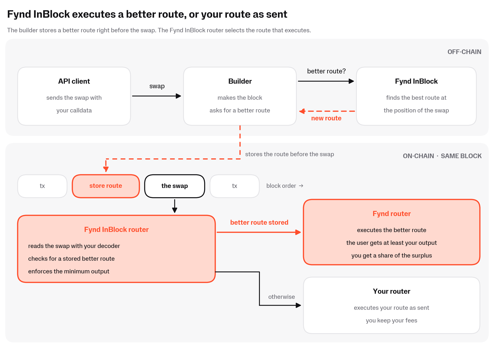
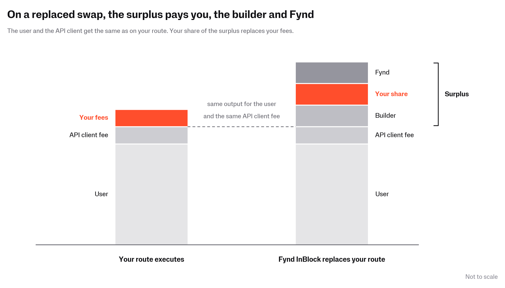

# Fynd InBlock for DEX Aggregators

## What Fynd InBlock gives you

Fynd InBlock executes your quotes with a better route when the block has one. When your route is the best route, it executes as sent, and you keep all your fees on that swap.

When you route your swaps through Fynd InBlock, you get:

* **Your normal fees** on each swap that executes your original route.
* **A share of the surplus** on each swap where Fynd InBlock replaces your route.
* **More swaps that go through.** If prices move and your route can no longer give the minimum output, a better route can still give it.
* **No change to your router contract.**

The user always gets at least the output of your route, so your API clients can offer Fynd InBlock to their users with no loss on the price.

## How a swap executes

<figure><picture><source srcset="../.gitbook/assets/inblock-aggregators-flow-dark.png" media="(prefers-color-scheme: dark)"></picture><figcaption>
How a swap executes through Fynd InBlock
</figcaption></figure>

Your API client sends the swap to the Fynd InBlock router (`FyndJITRouter` contract) with your calldata. If the builder stored a better route, the Fynd router (`TychoRouterV3` contract) executes it. If not, or if the better route fails, your router executes the swap as sent.

## Where the money comes from

<figure><picture><source srcset="../.gitbook/assets/inblock-aggregators-split-dark.png" media="(prefers-color-scheme: dark)"></picture><figcaption>
Who gets what on each path (not to scale)
</figcaption></figure>

Fynd InBlock pays all shares from the surplus, the extra output of the better route. The user pays no fee for a replacement. If there is no better route, there is no surplus, and nobody gets a share.

| Party      | When your route executes  | When Fynd InBlock replaces your route |
| ---------- | ------------------------- | ------------------------------------- |
| User       | The output of your route  | At least the output of your route     |
| API client | Its integrator fee        | The same fee, if Fynd InBlock knows it |
| You        | Your router fees          | A share of the surplus                |
| Builder    | Nothing                   | A share of the surplus                |
| Fynd       | Nothing                   | The rest of the surplus               |

The size of your share is a part of your agreement with Fynd.

## Integration steps

1. Write a decoder contract for your router that implements the `IJITDecoder` interface. You or the Fynd team can write it.
2. If the decoder cannot read all the swap data from your calldata, encode the missing data as an explicit order.
3. Change the quotes that your API returns for Fynd InBlock:
   * The transaction goes to the Fynd InBlock router, not to your router.
   * The calldata is `jitSwap(yourRouter, yourCalldata)`. With an explicit order, it is `jitSwapWithOrder(yourRouter, yourCalldata, explicitOrder)`. Your calldata does not change.
   * The quote names the Fynd InBlock router as the caller (the taker) and the user as the receiver.
   * The address for the token approval is the Fynd InBlock router, not your router.

### Requirements for your router

| Your router must | Reason |
| ---------------- | ------ |
| Accept a contract as the caller, and take the input tokens from the caller. | The Fynd InBlock router calls your router. It holds the input tokens of the user during the swap. |
| Pay the output to the receiver in the calldata, not to the caller. | The Fynd InBlock router keeps no tokens. It stops a swap that pays the output to it. |
| Spend all of the input amount. | Fynd InBlock does not replace a route that spends less. Such a route still executes as sent. |
| Show the swap data in the calldata: input token, input amount, output token, receiver and minimum output. | Fynd InBlock needs this data to find and check a better route. |
| ↳ Or send the missing data in an explicit order. | Use an explicit order when the decoder cannot read some of this data from your calldata. The input token and the input amount must always be in your calldata. |
| Use all of the native ETH that it gets. | The Fynd InBlock router cannot receive ETH. A swap that sends ETH back to the caller fails. |
| Charge integrator fees as a percentage. | Fynd InBlock then keeps the integrator fee on a replaced swap. The decoder reads the fee from your calldata, or you send it in the explicit order. With other fees, your route executes as sent. |

If a swap does not meet a requirement, Fynd InBlock does not replace it. The swap executes as sent, or it stops before it moves funds.

## Protections for users and for you

* **Minimum output.** The user always gets at least the minimum output of your quote. The contract checks this on each swap.
* **Output of your route.** On a replaced swap, the user gets at least the output of your route. The builder calculates this value, and Fynd suggests no route that gives the user less.
* **Fallback.** If the better route fails, the contract executes your route as sent.
* **No balances.** The Fynd InBlock router keeps no tokens after a swap. It gives your router an approval for the exact input amount, and removes the approval after the call.
* **Only known routers.** The Fynd InBlock router calls only routers that have a registered decoder.
* **Fast stop.** Fynd can stop all replacements for your router at once. Your swaps then execute as sent.

### Known limits

These swaps work through your router directly, but fail through Fynd InBlock:

* A swap to a token that takes a fee on each transfer. The receiver's balance can then increase by less than the minimum output.
* A swap to a receiver contract that sends the ETH it gets to a different address.
* A swap with a permit in your calldata. The permit gives an allowance to your router, not to the Fynd InBlock router. The user must approve the Fynd InBlock router.

## Questions

**What do I lose on a replaced swap?** Your router does not execute, so it takes no fees or positive slippage on that swap and emits no events for it. Your share of the surplus replaces these fees.

**What happens when Fynd InBlock finds no better route?** Your route executes as sent. You keep all your fees. There is no surplus, so nobody gets a share.

**Does the user pay for Fynd InBlock?** The user pays no fee for a replacement. All shares come from the surplus. The Fynd InBlock router adds some gas to each swap: about 28k gas when your route executes and about 68k gas when Fynd InBlock replaces it, on Ethereum Mainnet ([details](fynd-in-block-solver.md#better-price-guarantee)).

**What must my API clients change?** They send the transaction to the Fynd InBlock router, and their users approve the Fynd InBlock router.

**Which chains are supported?** Ethereum Mainnet only, for now.

## Next step

To start, contact the Fynd team on [Telegram](https://t.me/tanay_j). The Fynd InBlock router address is on the [Fynd InBlock page](fynd-in-block-solver.md#contract-addresses).
