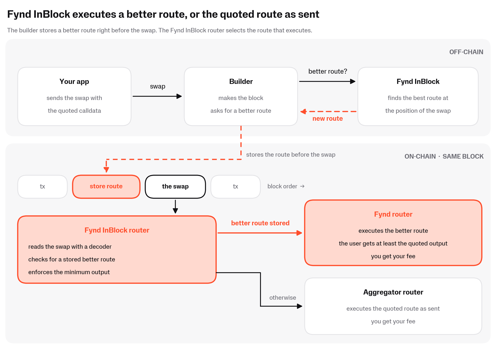
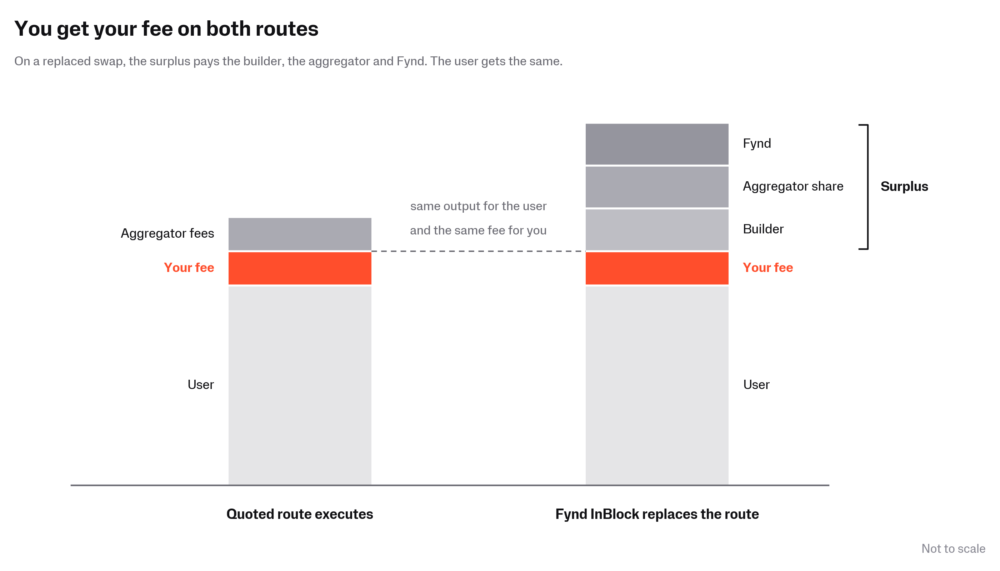

# For Swap Frontends

## What Fynd InBlock gives you

Fynd InBlock executes your users' swaps with a better route when the block has one. You keep your aggregators and your quotes. You change only where the transaction goes and which contract the user approves.

When you route your users' swaps through Fynd InBlock, you get:

* **More swaps that go through.** If prices move and the quoted route can no longer give the minimum output, a better route can still give it.
* **Your fee on each swap.** You get your fee when the quoted route executes and, if Fynd InBlock knows your fee, when Fynd InBlock replaces the route.
* **No loss for your users.** Users always get at least the output of the quoted route.
* **One change for all supported routers.** The same change works for the Fynd router and for each supported aggregator router.

## How a swap executes

<figure><picture><source srcset="../.gitbook/assets/inblock-frontends-flow-dark.png" media="(prefers-color-scheme: dark)"></picture><figcaption>
How a swap executes through Fynd InBlock
</figcaption></figure>

Your app sends the swap to the Fynd InBlock router (`FyndJITRouter` contract) with the quoted calldata. If the builder stored a better route, the Fynd router (`TychoRouterV3` contract) executes it. If not, or if the better route fails, the aggregator router executes the swap as sent.

## Where the money comes from

<figure><picture><source srcset="../.gitbook/assets/inblock-frontends-split-dark.png" media="(prefers-color-scheme: dark)"></picture><figcaption>
Who gets what on each path (not to scale)
</figcaption></figure>

Fynd InBlock pays all shares from the surplus, the extra output of the better route. The user pays no fee for a replacement. If there is no better route, there is no surplus, and nobody gets a share.

| Party      | When the quoted route executes | When Fynd InBlock replaces the route    |
| ---------- | ------------------------------ | --------------------------------------- |
| User       | The output of the quoted route | At least the output of the quoted route |
| You        | Your fee                       | Your fee, if Fynd InBlock knows it      |
| Aggregator | Its router fees                | A share of the surplus                  |
| Builder    | Nothing                        | A share of the surplus                  |
| Fynd       | Nothing                        | The rest of the surplus                 |

## Integration steps

Pick one of two paths.

### Path A: aggregator prepares the calldata

On this path you don't modify the calldata returned by the aggregator API.

1. Check with your aggregator or the Fynd team if your aggregator supports Fynd InBlock. On this path, this is required.
2. Request Fynd InBlock quotes from the aggregator API. Notice the differences from regular quotes that you may need to account for:
   1. The transaction's `to` field is the Fynd InBlock router.
   2. The address for the token approval is the Fynd InBlock router, not the aggregator router.
3. Give the transaction to the user, as usual.

### Path B: you prepare the calldata

Use this path when you prepare the calldata yourself. Your aggregator's API doesn't need to support Fynd InBlock. The swap can go through your own contract.

1. Check that Fynd InBlock has a decoder for each aggregator router you use. If one is missing, you or the Fynd team can write it.
2. When requesting a quote from the aggregator API, specify the Fynd InBlock router as the caller (the taker). Set the receiver to the user or to your contract.
3. Call the Fynd InBlock router, not the aggregator router. The calldata is `jitSwap(aggregatorRouter, quoteCalldata)`. This call can be made by the user directly, or through your contract.
4. If the decoder cannot read all the swap data from the quote calldata, send the missing data as an explicit order. The calldata is then `jitSwapWithOrder(aggregatorRouter, quoteCalldata, explicitOrder)`.
5. Approve the Fynd InBlock router for the input token. The caller (the user or your contract) must grant this approval. Fynd InBlock router takes input tokens from the caller and returns unused input tokens to them.

### Your fee on a replaced swap

Fynd InBlock preserves your fee only when it knows its rate. It learns the fee rate from the original calldata, or from an explicit order. In path A, the aggregator API controls the explicit order. In path B, you control it.

On a replaced swap, the Fynd router pays this fee in the output token, as a balance in the Fynd router. You can withdraw this balance at any time.


If Fynd InBlock does not know your fee rate, you get no fee on a replaced swap.


In path B, your contract can also take the fee from the output after the swap. Fynd InBlock then does not need to know the fee.

## Protections for your users

* **Minimum output.** The user always gets at least the minimum output of the quote. The contract checks this on each swap.
* **Output of the quoted route.** On a replaced swap, the user gets at least the output of the quoted route. The builder calculates this value, and Fynd doesn't suggest routes that give the user less.
* **Fallback.** If the better route fails, the contract executes the quoted route as sent.
* **No balances.** The Fynd InBlock router keeps no tokens after a swap. It gives the aggregator router an approval for the exact input amount, and removes the approval after the call.
* **Only known routers.** The Fynd InBlock router calls only routers that have a registered decoder.
* **Fast stop.** Fynd can stop all replacements for one router at once. The swaps then execute as sent.

### Known limits

These swaps work through the aggregator router directly, but fail through Fynd InBlock:

* A swap to a token that takes a fee on each transfer. The receiver's balance can then increase by less than the minimum output.
* A swap to a receiver contract that sends the ETH it gets to a different address.
* A swap with a permit for the aggregator router in the calldata.
* A quote with a market maker order that names a different caller. Ask for the quote with the Fynd InBlock router as the caller.

## Questions

**What do my users see?** In path A, they approve the Fynd InBlock router once per token. In path B, their approvals do not change - they still approve your router. In both paths, they get at least the output of the quoted route.

**What happens when Fynd InBlock finds no better route?** The quoted route executes as sent. You get your fee as usual.

**Does the user pay for Fynd InBlock?** The user pays no fee for a replacement. All shares come from the surplus. The Fynd InBlock router adds some gas to each swap: about 28k gas when the quoted route executes and about 68k gas when Fynd InBlock replaces it, on Ethereum Mainnet ([details](fynd-in-block-solver.md#better-price-guarantee)).

**What if the router of my quote is not supported?** Send the swap to that router directly, as you do now. Ask your aggregator or the Fynd team to add a decoder for that router.

**Which chains are supported?** Ethereum Mainnet only, for now.

## Next step

To start, contact the Fynd team on [Telegram](https://t.me/tanay_j). The Fynd InBlock router address is on the [Fynd InBlock page](fynd-in-block-solver.md#contract-addresses).
